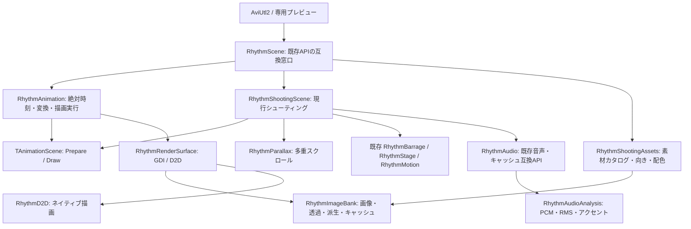

# アニメーションの構成と拡張（2026-10-30）

基準は `D:\DelphiProg\MyApp\SYNC_RhythmShooter` の `3cab353aea5481a0fc16e6879ef627eab1092938`。着手時の作業ツリーはクリーンで、受入済みの敵造形・通常敵の配色・下方進入を含んでいた。別の古いチェックアウトは使用していない。

今回はソース整理と静的確認だけ。**コンパイル・実行・配備は未確認**であり、以前のビルド成功は今回の結果ではない。ビルドはユーザーが行う。

## 責務と依存方向

共有描画実行部は音声クラス、敵、弾、ボス、クリア状態を参照しない。シーンは任意の絶対時刻を受け取って描く。音声など入力データの結び付け方は各シーンの責任とし、汎用オブジェクトへのキャストや全モード共通の巨大設定レコードは設けていない。

### 共有できる部分

| ファイル | 責務 |
|---|---|
| `Source/Audio/RhythmAudioAnalysis.pas` | 44.1kHz・ステレオS16 PCMからRMS波形とアクセントを求める純粋処理。時刻・強度・解析位置だけを返し、敵レーンや弾速を知らない。 |
| `Source/Engine/RhythmImageBank.pas` | 素材カタログ、標準画像と検証済みカスタム参照の読込、透過、回転、アルファ画像、画像選択キー。機体配色や機種番号を持たない。 |
| `Source/Engine/RhythmRenderSurface.pas` | 描画面、GDI/D2Dの選択、ピクセル単位のスプライト描画、縮小画像キャッシュ、GPUリソースの再作成と解放。 |
| `Source/Engine/RhythmParallax.pas` | 既存の3層背景、固定シードの星、カスタム背景の繰返し表示。敵や音楽には依存しない。 |
| `Source/Engine/RhythmAnimation.pas` | `TAnimationFrame`、差替え口の `TAnimationScene`、実行部 `TAnimationRenderer`。絶対時刻・描画範囲・方向、拡大/X/Y、描画失敗時のGDI再描画、共通メッセージ。 |
| 既存 `RhythmPlayback` / `RhythmPaths` / `RhythmDesignImages` 等 | 音声時計、ファイル位置、画像の検証・保存。今回の振舞いは変更していない。 |

`RhythmD2D.Create` には任意の透過色マスクを追加した。既存の1引数呼出しも残し、既定の透過色処理は従来どおり。新しい素材カタログでは「0番・3番だけ不透明」という番号規則を描画基盤へ持ち込まず、素材定義から渡せる。

### シューティング固有部分

- `RhythmShootingAssets.pas`：現行15素材・9派生画像の定義、敵の受入済み配色、横向き/上向き、アルファ派生の対象。画像準備は素材バンクの構築完了後に一度だけ行い、画像変更時だけ再作成する。カスタム画像の色は加工しない。
- `RhythmShootingScene.pas`：弾幕・編隊の計画キャッシュ、命中逆算、通常敵・ボス・弾・爆発の描画、登場・クリア・離脱、素材の表示サイズと向き。既存の描画順序と数式を移した。
- `RhythmBarrage` / `RhythmStage` / `RhythmMotion` / `RhythmSections`：既存のシューティング計画と動作。歴史的なファイル位置は保ち、今回ロジックを変更していない。これらは汎用の時間/解析モデルとは扱わない。
- `RhythmScene.pas`：既存の `TRhythmRenderer` と `PlayerAt` / `EnemyAt` / `BulletAt` / `ExplosionOpacity` を維持する約74行の互換窓口。ホストとプレビューが同じ現行シーンを使う。

`RhythmAudio` も互換境界である。音声読込・キャッシュと従来の `TRhythmHit` / ボス参照を残し、解析本体だけを共有ユニットへ委譲した。旧キャッシュに必要な `lane` / `flight` はこのアダプターで従来どおり算出する。将来のアニメーションが `RhythmAudioAnalysis` を使う際、これらのゲーム用フィールドを使う必要はない。キャッシュ形式の全面移行はしていない。

## 別アニメーションを追加する手順

1. `TAnimationScene` を継承したシーンを追加する。必要な音楽解析や専用データを、そのシーンの型付きプロパティ等で渡す。`Prepare(Frame)` はデータ/設定/描画範囲の変更に応じた計画の準備、`Draw(Surface, Frame)` は指定された絶対時刻の描画に限定する。前フレームの進行、壁時計、グローバル乱数へ依存させない。 描画はGDI/D2D共通の Surface.DrawAsset を使う。Canvasへの直接GDI描画を使うシーンは UseD2D をFalseにする（試験プローブもこの経路）。共有Parallaxを使う場合は背景6スロットを方向×3層の順に用意する。
2. 素材が必要なら `TAnimationImageBank` を継承し、標準ファイル名・表示名・不透明/透過のカタログと派生画像を定義する。色調整などは `PrepareImages` に置き、カスタム画像には無断適用しない。`EnsurePrepared` は描画面が構築後に自動で呼ぶので、基底コンストラクタから未構築の派生状態を呼び出さない。
3. 構成箇所で `TAnimationRenderer.Create(新しいシーン, 新しい素材バンク)` と結び付ける。描画基盤や既存シューティングへモード分岐を追加しない。現行の `RhythmScene` はシューティング用の構成例であり、新しいシーンから参照しない。
4. アニメーション実行部はシーンと素材バンクを所有して解放する。音楽等の入力データはシーンが借用するので、`Prepare` / `Draw` の実行中は呼出側が生存を保証する。画像の標準復帰・選択変更は `ApplyChoices` を通し、派生画像・縮小キャッシュ・GPU登録を整合させる。
5. 現行の15スロットJSONとUIはシューティングの互換境界である。将来、新しい素材カタログやモード固有設定を公開する際は、そのモードの設定/移行を別途設計し、旧IDを別の意味へ置き換えない。今回モード選択UIや別アニメーション本体は追加していない。

共有コアの使用例は新しい試験ソース `Tests/AnimationArchitectureSmoke.dpr` にある。素材・音楽・シューティングを持たない描画プローブを差し込み、途中シークと変換の契約を調べるための試験であり、製品の新モードではない。

## 維持した互換性

- AviUtl2の必須export、公開設定、SDK型、JSONスキーマ1と素材ID、AI作成・候補採用の導線は変更していない。
- PCM/イベントキャッシュ名、schema、analysisVersion、検証・読込・書込、ロードスレッドは維持。RMS・アクセント検出の数式も維持し、抽出結果に従来と同じ整数ハッシュでレーンを付ける。
- プレビューも本番も従来の `TRhythmRenderer` を経由する。拡大/X/Yを変えて音声解析を開始する経路は追加していない。
- 受入済み通常敵の色補正は数式を変えずに移動。標準BMP、カスタム画像、素材参照、ユーザー設定を書き換えていない。
- スプライトの表示サイズ、GDIとD2Dそれぞれの座標丸め、透明度、回転方向、背景の種・速度、戦闘/クリアの数式を維持した。

## 参照設定とユーザー側での確認

主 `SYNC_RhythmShooter.dpr` / `.dproj` と `Tools/RhythmPreview.dpr` に新規7ユニットを追加。新規ファイルは既存の Audio / Engine フォルダに置き、既存テストのユニット探索パスで解決できるようにした。通常のビルドイベントや配備設定は変更していない。IDEでプロジェクトを開いたままなら外部変更後の参照一覧を再読込する。

- `Tests/AnimationArchitectureSmoke.dpr` と `Scripts/TestArchitecture.cmd` を追加。ユーザーがスクリプトを呼ぶと、専用の `Win64/ArchitectureTests` へ試験をコンパイルして非GUI実行する。製品のビルド後イベント・配備は呼ばず、音声デコード・再生やAI通信も行わない。
- この試験はシーン差替え、絶対時刻・シーク・拡大/X/Y、既知PCMのアクセントと従来レーン/弾速の適合を対象とする。
- 既存 `CombatSmoke` / `LowerEnemySmoke`、設定保存・カスタム素材関連の試験ソースは維持した。今回のリンク構成での画像、決定的シーク、音ハメ、クリア、カスタム画像とJSON再開はユーザー側のビルド/回帰で確認が必要。

## 今回実施した静的確認

全追跡ファイルの着手時ハッシュを保管し、上書き前にHEAD・作業ツリー・ハッシュ一致を確認した。受入済み配色の移動、戦闘描画の順序と数式、既存音声API、キャッシュ処理の残存をソース照合した。共有描画部/解析部にゲーム用ユニット参照がないこと、ローカル31ユニットの依存に循環がないこと、新規参照の整合とXML、差分の空白を静的確認した。

これらはコンパイルや実行の代わりではない。**今回のソースは未ビルドで、新しい試験も未実行。** アプリ起動・実表示・音声同期・GUI保存再開・配備・commit/push は行っていない。
