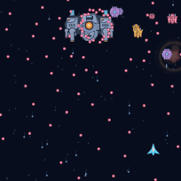

# リズムシューティング

**SYNC_RhythmShooter** は、WAV・MP3の音楽に合わせてゲーム風の映像を自動生成する、AviUtl ExEdit2（AviUtl2）用のフィルタプラグインです。曲のアクセントに合わせて、砲弾の着弾、敵の撃破、ジャンプやコインの取得などが起きます。



## 選べる映像

設定画面で13種類のバリエーションを切り替えられます。

| 分類 | バリエーション |
| --- | --- |
| シューティング | 宇宙シューティング（縦／横）、装甲列車 |
| ボールアクション | ピンボール（縦／横）、ブロック崩し |
| アクション | ジャンプアドベンチャー、爆弾アクション、格闘ラッシュ、掘削アクション、トロッコアクション、クラッシュキャノン |
| レース | 2Dハイウェイ |
| 音楽・演出 | Type.V（惑星を巡る透明オーバーレイ）、Type.D（縦4レーン） |

## インストール

Windows x64版のAviUtl2で使用できます。

1. [GitHub Releases](https://github.com/vramwiz/SYNC_RhythmShooter/releases) から `SYNC_RhythmShooter.zip` を入手します。
2. ZIPを展開し、中の `SYNC_RhythmShooter` フォルダをAviUtl2の `Plugin` フォルダに入れます。通常の配置先は `C:\ProgramData\aviutl2\Plugin\SYNC_RhythmShooter` です。
3. AviUtl2を起動し、対象オブジェクトに「SYNC」グループの「リズムシューティング」フィルタを追加します。

## 使い方

1. AviUtl2のフィルタ項目 **音楽ファイル** で、WAVまたはMP3を指定します。
2. **設定** を開き、バリエーションや解析感度を選びます。未解析の場合は **準備/再試行** または **解析** を押します。準備が完了したら、音楽付きプレビューで映像を確認します。
3. **適用して閉じる** を押し、AviUtl2のプロジェクトを保存します。音楽ファイルやバリエーションを変えた場合は、設定画面で再準備してから適用します。

音声付きで書き出す場合は、同じ音楽をタイムラインに置き、フィルタを適用したオブジェクトと開始位置をそろえてください。映像のタイミングはフィルタ項目 **オフセット** で調整できます。負の値で早まり、正の値で遅くなります。

## ビルドと配布

ビルド環境はDelphi 37.0／Win64です。リポジトリのルートで以下を実行すると、AviUtl2への配備を行わずに `Win64/Local/SYNC_RhythmShooter/Release` にビルドできます。

```powershell
.\Scripts\Build.ps1 -Config Release -NoDeploy
```

配布ZIPの作成とAviUtl2カタログへの登録手順は [Setupの手順書](Setup/README.md) を参照してください。

## 作者・同梱物

作者は **VRAMの魔術師** です。本プラグインは [MITライセンス](LICENSE) で公開しています。

MP3は同梱の純Delphiデコーダー（minimp3由来、CC0）、WAVはWindows標準のMedia Foundationで読み込みます。プレビュー再生はWindowsのwaveOutを使用し、FFmpegや追加のデコーダーEXE・DLLの同梱は不要です。同梱物の出典とライセンスは [第三者同梱物の記録](THIRD_PARTY_NOTICES.md) を参照してください。

旧版の音声キャッシュは残して、新しいデコーダー用のPCM・解析キャッシュを別名で保存します。更新後にプレビューの準備を求められた場合は、設定画面で再準備してください。WAVの対応形式はWindowsに搭載されたコーデックに従います。
